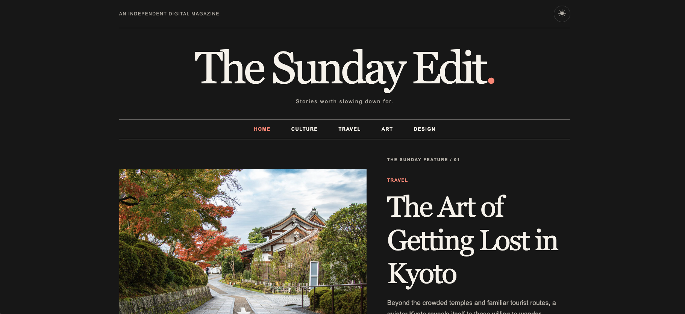
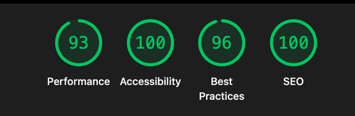

# The Sunday Edit

A responsive, interactive editorial website exploring culture, travel, art, and design.

Built as a frontend development portfolio project with an emphasis on digital publishing, accessibility, performance, and reusable architecture.

## Project Links

- [Live Website](https://annabananacat.github.io/the-sunday-edit/)
- [GitHub Repository](https://github.com/annabananacat/the-sunday-edit)

## Project Preview



## Features

- Responsive magazine-style editorial layout
- Featured story and article directory
- Interactive category filtering
- Dynamic article counts
- Reusable article detail template
- URL-based article selection
- Automatically calculated reading times
- Reading progress indicator
- Light and dark mode
- Persistent theme preferences
- Accessible mobile navigation
- Keyboard navigation and focus indicators
- Reduced-motion support
- Article-not-found error handling

## Technologies

- HTML5
- CSS3
- JavaScript (ES6+)
- CSS Grid and Flexbox
- CSS custom properties
- Local Storage API
- URLSearchParams
- Git and GitHub Pages

## Design System

The visual design draws inspiration from independent editorial publications.

The interface combines oversized serif typography, warm neutral colors, terracotta accents, editorial photography, and generous whitespace.

Reusable CSS variables maintain visual consistency across light and dark themes.

## Accessibility

- Semantic HTML structure
- Image alternative text
- Skip-to-content navigation
- Accessible button states
- Visible keyboard focus indicators
- Keyboard-accessible mobile navigation
- Dynamic article count announcements
- Reduced-motion preferences
- Responsive typography and layouts

## Performance Optimization

The initial Lighthouse audit returned a performance score of 39.

Image resizing and compression reduced the combined photograph file size from approximately 25 MB to 2 MB, representing a 92% reduction after initial optimization.

Additional optimization strategies include:

- Lazy loading below-the-fold images
- High-priority loading for featured photography
- Deferred JavaScript execution
- Explicit image dimensions
- System fonts
- No external framework dependencies

## Lighthouse Results

Live homepage audit — November 22, 2026.

| Category | Initial | Final |
| --- | --- | --- |
| Performance | 39 | 93 |
| Accessibility | 100 | 100 |
| Best Practices | 96 | 96 |
| SEO | 100 | 100 |



Performance improved from an initial local score of 39 to a live website score of 93.

Lighthouse scores may vary depending on the testing environment, browser activity, and network conditions.

## Project Architecture

- `index.html` — Editorial homepage
- `article.html` — Reusable article template
- `styles.css` — Design system and responsive layouts
- `script.js` — Shared interactive functionality
- `articles.js` — Editorial data and dynamic rendering
- `images/` — Optimized editorial photography

## Running Locally

Clone the repository and start a local server:

```bash
git clone https://github.com/annabananacat/the-sunday-edit.git
cd the-sunday-edit
python3 -m http.server 8000
```

Open http://localhost:8000/ in your browser.

No external dependencies or build tools are required.

## Project Limitations

This project uses client-side article rendering and sample editorial content rather than a production CMS.

Automated Lighthouse accessibility results complement, but do not replace, comprehensive manual accessibility testing.

## Future Improvements

- WordPress or headless CMS integration
- Server-rendered article pages
- Responsive WebP and AVIF image delivery
- Automated accessibility and functionality tests
- Related article recommendations
- Article bookmarking
- Editorial search functionality

## Credits

Designed and developed as a frontend portfolio project by Anna Wolansky.
